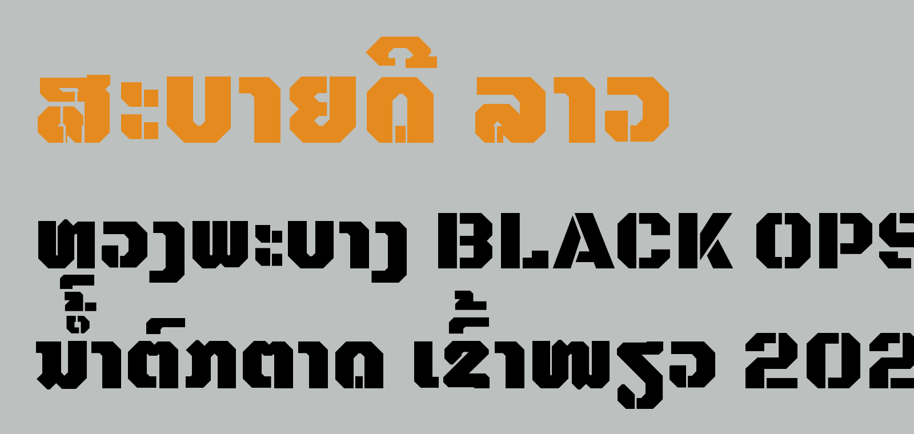
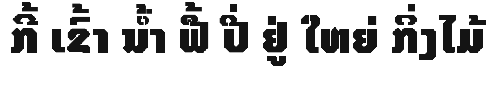
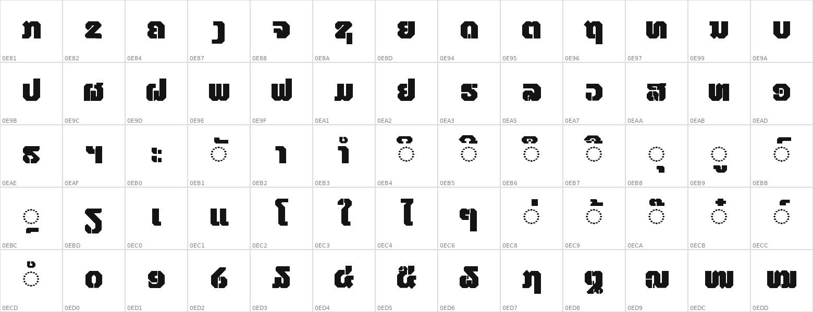

# Kamphaeng ກຳແພງ

**A heavy stencil font for Lao headlines, posters and signs.** Free and open source under the
[SIL Open Font License 1.1](OFL.txt). **Status: beta (version 0.110).**

[ພາສາລາວ](#ພາສາລາວ) · [Try it online](https://rcampbellbassac.github.io/Kamphaeng/) ·
[Download](https://github.com/rcampbellbassac/Kamphaeng/releases/latest/download/Kamphaeng.zip)



## What it is

Kamphaeng (ກຳແພງ means "wall") is a bold display font in the spirit of
[Black Ops One](https://fonts.google.com/specimen/Black+Ops+One). Its Lao letters are built from
straight lines and 45-degree corners with stencil cuts. Latin letters, numbers and punctuation come
from Black Ops One, so Lao and English mixed in one line look like one family.

- Full modern Lao: all 27 consonants, vowels, tone marks, ໜ ໝ ຫຼ, Lao digits
- Vowels and tone marks stack correctly (Noto Sans Lao's OpenType layout is kept)
- Latin, digits and punctuation from Black Ops One
- TTF for apps, WOFF2 for websites



> **Beta.** Letter shapes, spacing and stencil gaps may still change before 1.0.
> If a letter looks wrong, please [open an issue](https://github.com/rcampbellbassac/Kamphaeng/issues).

## Install

1. Download `Kamphaeng.zip` from the [latest release](https://github.com/rcampbellbassac/Kamphaeng/releases/latest).
2. Unzip it and open `Kamphaeng-Regular.ttf`.
3. Click **Install**. The font is now available in Word, LibreOffice, Canva and your other apps.

On a website:

```css
@font-face {
  font-family: "Kamphaeng";
  src: url("Kamphaeng-Regular.woff2") format("woff2");
  font-display: swap;
}
h1 { font-family: "Kamphaeng", "Noto Sans Lao", sans-serif; }
```

## Characters



## How it is made

| Path | What |
|---|---|
| `sources/Kamphaeng-Regular.ufo` | Lao design source (UFO), edited in FontLab 7 |
| `design/overrides.json` | per-letter design decisions (extra stencil cuts, tolerances) |
| `scripts/derive.py` | regenerates Lao letters from Noto Sans Lao Black: straight 0/45/90-degree edges, then stencil gaps |
| `scripts/build.py` | builds `fonts/Kamphaeng-Regular.ttf` and `.woff2` (Lao + Black Ops One Latin) |
| `docs/` | the demo website (GitHub Pages) |

Letters edited by hand in FontLab are listed in the UFO's `kamphaeng.locked` lib key so the generator
never overwrites them. The build tools live in a separate project (fontlab-mcp).

## Credits and license

Designed by Robert Martin Campbell. Lao letters are derived from
[Noto Sans Lao](https://github.com/notofonts/lao) (Copyright 2022 The Noto Project Authors).
Latin letters are from [Black Ops One](https://github.com/googlefonts/blackops) by James Grieshaber
and Eben Sorkin (Copyright 2022 The Black-Ops Project Authors). Both are licensed under the SIL OFL 1.1
with no Reserved Font Name. Kamphaeng is licensed under the [SIL Open Font License 1.1](OFL.txt): free
to use, share, change and sell with other software, including for commercial work. See
[FONTLOG.txt](FONTLOG.txt).

---

## ພາສາລາວ

**ກຳແພງ (Kamphaeng)** ເປັນຟອນ stencil ແບບໜາ ສຳລັບຫົວຂໍ້, ໂປສເຕີ ແລະ ປ້າຍພາສາລາວ.
ໃຊ້ໄດ້ຟຣີ ພາຍໃຕ້ SIL Open Font License 1.1. **ສະຖານະ: ເບຕ້າ (ເວີຊັນ 0.110).**

[ລອງໃຊ້ອອນລາຍ](https://rcampbellbassac.github.io/Kamphaeng/?lang=lo) ·
[ດາວໂຫລດຟອນ](https://github.com/rcampbellbassac/Kamphaeng/releases/latest/download/Kamphaeng.zip)

ຕົວອັກສອນລາວຖືກສ້າງຈາກເສັ້ນຊື່ ແລະ ມຸມ 45 ອົງສາ ພ້ອມຮອຍຕັດແບບ stencil,
ໄດ້ຮັບແຮງບັນດານໃຈຈາກຟອນ Black Ops One ທີ່ນິຍົມ. ຕົວອັກສອນລາວອີງໃສ່ Noto Sans Lao.
ສະຫຼະ ແລະ ວັນນະຍຸດທຸກຕົວຢູ່ໃນບ່ອນທີ່ຖືກຕ້ອງ, ເຖິງແມ່ນວ່າຈະມີສອງຕົວຊ້ອນກັນຢູ່ເທິງພະຍັນຊະນະດຽວກໍຕາມ.

> **ເບຕ້າ:** ຮູບຮ່າງຕົວອັກສອນ, ໄລຍະຫ່າງ ແລະ ຮອຍຕັດ stencil ອາດຈະຍັງມີການປ່ຽນແປງ.
> ພົບບັນຫາກັບຕົວອັກສອນໃດໜຶ່ງບໍ? [ແຈ້ງບັນຫາ (issue) ໃນ GitHub](https://github.com/rcampbellbassac/Kamphaeng/issues).

### ວິທີການຕິດຕັ້ງ

1. ດາວໂຫລດໄຟລ໌ `Kamphaeng.zip` ຈາກ[ເວີຊັນລ່າສຸດ](https://github.com/rcampbellbassac/Kamphaeng/releases/latest).
2. ແຕກໄຟລ໌ zip ແລ້ວເປີດ `Kamphaeng-Regular.ttf`.
3. ກົດ **Install** (ຕິດຕັ້ງ). ຟອນຈະໃຊ້ໄດ້ໃນ Word, LibreOffice, Canva ແລະ ແອັບອື່ນໆ.

ສຳລັບເວັບໄຊທ໌, ໃຊ້ໄຟລ໌ WOFF2.

ອອກແບບໂດຍ Robert Martin Campbell. ຕົວອັກສອນລາວມາຈາກ Noto Sans Lao ໂດຍຜູ້ຂຽນໂຄງການ Noto.
ຕົວອັກສອນລາຕິນຈາກ Black Ops One ໂດຍ James Grieshaber ແລະ Eben Sorkin.

<sub>ພາສາລາວໃນໜ້ານີ້ແປດ້ວຍ Google Translate ແລະ ແກ້ໄຂບາງສ່ວນແລ້ວ.</sub>
